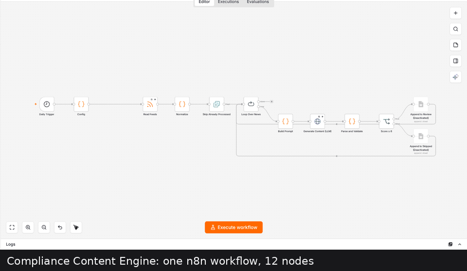
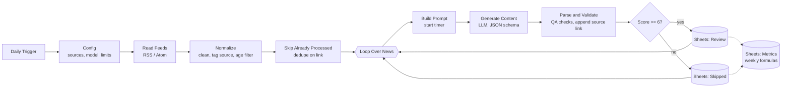

# Compliance Content Engine

An n8n workflow that reads official sanctions and anti-money-laundering announcements once a day and turns each one into three reviewed-ready marketing drafts (LinkedIn post, newsletter blurb, one-pager), scored for relevance and logged to Google Sheets with weekly metrics.

> **Independent demo.** This is a personal portfolio project. It is not affiliated with, endorsed by, or built for complead (formerly Sanction Scanner) or any other company. It uses no company branding. All news comes from public official sources. Output is a draft for human review, not legal or compliance advice.

<!-- After recording, save the GIF as docs/demo.gif and uncomment:

-->

## The problem

A RegTech marketing team needs a steady flow of timely content about sanctions and AML changes. The raw material is public and free, but someone has to watch several regulator feeds, decide what matters to banks and fintechs, and write the same story in three formats. That work is repetitive, and it is where invented details are most dangerous.

This workflow automates the watching, triage and first draft, and keeps a human in charge of what gets published.

## How it works



One workflow, 12 nodes, no database, no UI.

| Step | Detail |
|---|---|
| Trigger | Schedule Trigger, daily at 07:00. Run it by hand any time with **Execute workflow**. |
| Sources | Three public feeds, verified live on 2026-11-11 (table below). Add one by adding a line in the `Config` node. |
| Dedupe | n8n's Remove Duplicates node in "items processed in previous executions" mode, keyed on the article link. History lives in n8n's own data. |
| LLM | Google Gemini over plain HTTP with a response schema, so the answer is always the same JSON shape. Prompt and schema are in [`prompts/`](prompts/). |
| QA | Code checks after the model: word limits, required sections, score range, and every number in the draft must exist in the source text. Problems are written to `qa_flags`. |
| Source link | Appended by code, not by the model, so it cannot be missing or altered. |
| Filter | `relevance_score >= 6` goes to `Review`, everything else to `Skipped` with the reason. |
| Metrics | A `Metrics` tab built only from spreadsheet formulas. See [`sheets/template.md`](sheets/template.md). |

### Sources

| Source | Feed | Notes |
|---|---|---|
| UK OFSI | `https://www.gov.uk/government/organisations/office-of-financial-sanctions-implementation.atom` | Sanctions guidance, general licences, enforcement. |
| EU Council | `https://www.consilium.europa.eu/en/rss/pressreleases.ashx` | All Council press releases. Includes sanctions ("restrictive measures") among unrelated items, which is what the relevance filter is for. |
| US Federal Reserve | `https://www.federalreserve.gov/feeds/press_enforcement.xml` | Enforcement actions, including AML/BSA cases. |

Checked and rejected on the same day: OFAC `rss.xml` responds but its newest item is from February 2025; FinCEN and US Treasury press feeds returned 404; FATF blocks automated requests.

## Setup

Requirements: Node.js 20+ or Docker, a Google account, a free Gemini API key. Tested with n8n 2.35.7.

**1. Clone and create your local env file**

```bash
git clone <this-repo-url>
cd compliance-content-engine
cp .env.example .env
```

On Windows PowerShell use `Copy-Item .env.example .env`. Put your Gemini key in `.env` (get one at https://aistudio.google.com/apikey). `.env` is git-ignored.

**2. Smoke-test the prompt (no n8n needed)**

```bash
python scripts/smoke_test.py
```

It sends one real news item with the repo's prompt and schema and prints the JSON, word counts and latency. If the model name is rejected, run `python scripts/smoke_test.py --models` and put a listed Flash model in `scripts/smoke_test.py` and in the `Config` node.

**3. Create the Google Sheet**

Follow [`sheets/template.md`](sheets/template.md): three tabs (`Review`, `Skipped`, `Metrics`), the header row and the formulas. Copy the spreadsheet ID from its URL.

**4. Start n8n**

```bash
npx n8n
```

or with Docker:

```bash
docker run -it --rm --name n8n -p 5678:5678 --env-file .env -v n8n_data:/home/node/.n8n docker.n8n.io/n8nio/n8n
```

Open http://localhost:5678.

**5. Import and connect**

1. **Workflows -> Import from File** -> `workflow/compliance-content-engine.json`.
2. Open the `Config` node and replace `YOUR_SPREADSHEET_ID`.
3. Open `Generate Content (LLM)` -> create a **Google Gemini(PaLM) Api** credential with your key.
4. Open `Append to Review` and `Append to Skipped` -> create a Google Sheets credential. On self-hosted n8n the simplest route is a **Service Account**: enable the Google Sheets API in a Google Cloud project, create a service account key, switch the node's *Authentication* to Service Account, and share the sheet with the service account's email as Editor. On n8n Cloud, OAuth sign-in works in one click.
5. Click **Execute workflow**. Rows appear in `Review` and `Skipped`.
6. Click it again. `Skip Already Processed` should pass 0 items.
7. Toggle the workflow **Active** for the daily run.

The exported workflow contains no keys, no spreadsheet ID and no personal data. Credentials live only in n8n's encrypted credential store.

**Changing the prompt:** edit the files in `prompts/` or `workflow/code/`, then run `python scripts/build_workflow.py` to regenerate the workflow JSON and re-import it.

## Sample outputs

See [`samples/`](samples/): 5 unedited outputs from a real run on real news items.

Status: **to be generated** from the first real run.

## Measured results

Only measured numbers go here. Anything not yet measured says so.

| Metric | Value | How it is measured |
|---|---|---|
| News items processed (first week) | to be measured | `Metrics!B` |
| Drafts generated | to be measured | `Metrics!D` (3 per successful item) |
| Average generation time per item | to be measured | `Metrics!E`, wall-clock seconds of the LLM step |
| Share of items sent to review (score >= 6) | to be measured | `Metrics!C / Metrics!B` |
| Approval rate of reviewed drafts | to be measured | `Metrics!G`, status set by a human |
| Manual baseline: writing the 3 pieces by hand | to be measured | Stopwatch, typed into `Metrics!B2:B4` |
| Review time per AI draft set | to be measured | Stopwatch, typed into `Metrics!B6` |
| Estimated hours saved per week | to be measured | `approved x (manual - review) / 60`, see `sheets/template.md` |

What has been verified so far (2026-11-11, n8n 2.35.7, local run with a mocked LLM endpoint and the three live feeds): the feeds returned 55 items; a first run processed the new items and routed them by score; an LLM failure was written to `Skipped` with `status = error` instead of stopping the run; an immediate second run processed 0 items (9 of 9 recognised as already seen).

## Limits

- **Thin input.** The model only sees the feed's title and short summary, not the full article. Drafts are deliberately short on detail. Fetching the full page is the obvious next improvement.
- **Grounding checks are partial.** The number check catches invented figures, not invented names or claims. Human review is required; nothing is published automatically.
- **A failed item is not retried on the next run.** It is marked as seen before the LLM call. It lands in `Skipped` with `status = error` so it is visible.
- **Relevance score is a model judgement** against a written rubric. It has not been calibrated against human ratings.
- **The time-saved figure is an estimate** from one person's stopwatch baseline.
- **Free-tier rate limits.** Items are processed one at a time with retries; each source is capped at 6 items per run.
- **English only.** The EU Council feed is general, so most of its items are expected to land in `Skipped`.

## Next steps

- **Slack approval step:** post each `Review` draft to a channel with Approve / Reject buttons that update `status`.
- **HubSpot:** push approved newsletter blurbs into a draft marketing email and log the source as a campaign property.
- **Scheduled LinkedIn posting:** queue approved posts for set time slots, still behind human approval.
- Fetch full article text; add OFAC Recent Actions via page parsing; calibrate the relevance score on a hand-labelled set.

## Repository layout

```
workflow/compliance-content-engine.json   n8n export (generated, import this)
workflow/code/                            JavaScript of the Code nodes
prompts/system-prompt.md                  system prompt
prompts/output-schema.json                JSON response schema
scripts/build_workflow.py                 regenerates the workflow JSON
scripts/smoke_test.py                     one real LLM call without n8n
scripts/make_samples.py                   Review tab CSV -> samples/*.md
sheets/template.md                        sheet structure and Metrics formulas
samples/                                  real outputs
docs/recording-shotlist.md                shot list for the demo recording
```

## License

MIT. News content belongs to its publishers and is linked, not republished.
