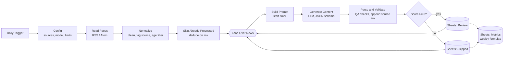

# Compliance Content Engine

An n8n workflow that reads official sanctions and anti-money-laundering announcements once a day and turns each one into three reviewed-ready marketing drafts (LinkedIn post, newsletter blurb, one-pager), scored for relevance and logged to Google Sheets with weekly metrics.

> **Independent demo.** This is a personal portfolio project. It is not affiliated with, endorsed by, or built for complead (formerly Sanction Scanner) or any other company. It uses no company branding. All news comes from public official sources. Output is a draft for human review, not legal or compliance advice.


*Recorded on a local n8n with the two Google Sheets nodes disabled (no Google credential on the recording machine), 2 items per source. Run 2 shows deduplication: nothing reaches the LLM.*

## The problem

A RegTech marketing team needs a steady flow of timely content about sanctions and AML changes. The raw material is public and free, but someone has to watch several regulator feeds, decide what matters to banks and fintechs, and write the same story in three formats. That work is repetitive, and it is where invented details are most dangerous.

This workflow automates the watching, triage and first draft, and keeps a human in charge of what gets published.

## How it works



One workflow, 12 nodes, no database, no UI.

| Step | Detail |
|---|---|
| Trigger | Schedule Trigger, daily at 07:00. Run it by hand any time with **Execute workflow**. |
| Sources | Three public feeds, verified live on 2026-11-11 (table below). Add one by adding a line in the `Config` node. |
| Dedupe | n8n's Remove Duplicates node in "items processed in previous executions" mode, keyed on the article link. History lives in n8n's own data. |
| LLM | Any OpenAI-compatible chat completions API with a strict JSON schema, so the answer always has the same shape. Default: Groq free tier, `openai/gpt-oss-120b`. Switching to Gemini, OpenAI or another provider is a URL + model change in `Config`. Prompt and schema are in [`prompts/`](prompts/). |
| QA | Code checks after the model: word limits, exactly three takeaway lines, required sections, score range, and every number in the draft must exist in the source text. Problems are written to `qa_flags`. |
| Source link | Appended by code, not by the model, so it cannot be missing or altered. |
| Filter | `relevance_score >= 6` goes to `Review`, everything else to `Skipped` with the reason. |
| Metrics | A `Metrics` tab built only from spreadsheet formulas. See [`sheets/template.md`](sheets/template.md). |

### Sources

| Source | Feed | Notes |
|---|---|---|
| UK OFSI | `https://www.gov.uk/government/organisations/office-of-financial-sanctions-implementation.atom` | Sanctions guidance, general licences, enforcement. |
| EU Council | `https://www.consilium.europa.eu/en/rss/pressreleases.ashx` | All Council press releases. Includes sanctions ("restrictive measures") among unrelated items, which is what the relevance filter is for. |
| US Federal Reserve | `https://www.federalreserve.gov/feeds/press_enforcement.xml` | Enforcement actions, including AML/BSA cases. |

Checked and rejected on the same day: OFAC `rss.xml` responds but its newest item is from February 2025; FinCEN and US Treasury press feeds returned 404; FATF blocks automated requests.

## Setup

Requirements: Node.js 20+ or Docker, a Google account, a free LLM API key (Groq by default). Tested with n8n 2.35.7.

**1. Clone and create your local env file**

```bash
git clone <this-repo-url>
cd compliance-content-engine
cp .env.example .env
```

On Windows PowerShell use `Copy-Item .env.example .env`. Put your key in `.env` as `LLM_API_KEY` (free Groq key: https://console.groq.com/keys). `.env` is git-ignored.

> Using Gemini instead: set `llmBaseUrl` to `https://generativelanguage.googleapis.com/v1beta/openai` and `model` to a Gemini model in `Config` (and in `scripts/smoke_test.py`). The free tier only works in a Google project without billing; a prepaid project with no credit left returns `402 RESOURCE_EXHAUSTED`.

**2. Smoke-test the prompt (no n8n needed)**

```bash
python scripts/smoke_test.py
```

It sends one real news item with the repo's prompt and schema and prints the JSON, word counts and latency. If the model name is rejected, run `python scripts/smoke_test.py --models` and put a listed model in `scripts/smoke_test.py` and in the `Config` node.

**3. Create the Google Sheet**

Follow [`sheets/template.md`](sheets/template.md): three tabs (`Review`, `Skipped`, `Metrics`), the header row and the formulas. Copy the spreadsheet ID from its URL.

**4. Start n8n**

```bash
npx n8n
```

or with Docker:

```bash
docker run -it --rm --name n8n -p 5678:5678 --env-file .env -v n8n_data:/home/node/.n8n docker.n8n.io/n8nio/n8n
```

Open http://localhost:5678.

**5. Import and connect**

1. **Workflows -> Import from File** -> `workflow/compliance-content-engine.json`.
2. Open the `Config` node and replace `YOUR_SPREADSHEET_ID`.
3. Open `Generate Content (LLM)` -> create a **Bearer Auth** credential and paste your API key as the token.
4. Open `Append to Review` and `Append to Skipped` -> create a Google Sheets credential. On self-hosted n8n the simplest route is a **Service Account**: enable the Google Sheets API in a Google Cloud project, create a service account key, switch the node's *Authentication* to Service Account, and share the sheet with the service account's email as Editor. On n8n Cloud, OAuth sign-in works in one click.
5. Click **Execute workflow**. Rows appear in `Review` and `Skipped`.
6. Click it again. `Skip Already Processed` should pass 0 items.
7. Toggle the workflow **Active** for the daily run.

The exported workflow contains no keys, no spreadsheet ID and no personal data. Credentials live only in n8n's encrypted credential store.

**Changing the prompt:** edit the files in `prompts/` or `workflow/code/`, then run `python scripts/build_workflow.py` to regenerate the workflow JSON and re-import it.

## Sample outputs

[`samples/`](samples/) holds 5 unedited outputs from the measured run below: three UK OFSI items, one EU sanctions statement and one Federal Reserve enforcement item. All 12 rows of that run (9 in `Review`, 3 in `Skipped`) were written to the author's Google Sheet.

## Measured results

One real run on 2026-11-11: three live feeds, Groq `openai/gpt-oss-120b`, n8n 2.35.7, `maxAgeDays: 30`, `maxItemsPerSource: 6`, 15 s pause between LLM calls.

| Metric | Value |
|---|---|
| Feed items read | 55 |
| New items processed (within 30 days, max 6 per source) | 12 |
| Drafts generated | 36 (3 per item), 0 failed LLM calls |
| Sent to `Review` (score >= 6) | 9 of 12 |
| Sent to `Skipped` | 3 of 12: an EU press-briefing notice (1), the EU 2027 budget (2), one Fed enforcement termination (3) |
| LLM time per item | mean 4.0 s, median 3.5 s, range 2.6-10.1 s |
| Wall-clock time for the whole run | 3 min 54 s, almost all of it the deliberate rate-limit pause |
| Word limits | LinkedIn 55-78 words (limit 120), newsletter 22-43 words (limit 60), 0 violations |
| QA flags raised | 1 of 12, a false positive: the model wrote "16:00" where the source says "16.00" |
| Second run on the same feeds | 0 of 12 items reprocessed, 0 LLM calls |
| LLM cost | $0 (Groq free tier) |
| Approved by a human reviewer | 7 of 9 `Review` items (78%): 3 as generated, 4 after one-word edits that removed overstatement ("several" -> "certain", "extending" -> "continuing"). Rejected: 1 duplicate licence item, 1 low-value enforcement termination |
| Manual baseline: writing the 3 pieces by hand | to be measured (stopwatch, `Metrics!B2:B4`) |
| Review time per AI draft set | to be measured (`Metrics!B6`) |
| Estimated hours saved per week | to be measured (`approved x (manual - review) / 60`) |

Not yet verified end to end: the two Google Sheets nodes writing from n8n. The run above executed in n8n with those two nodes stubbed, and its rows were written to the sheet separately with the same column layout. Connect your own Google credential (step 5) and the first run confirms it.

## Limits

Found by reading all 12 outputs against their source items:

- **Thin input.** The model only sees the feed's title and one-line summary, not the full article. Many "takeaways" are therefore suggested actions rather than facts from the news.
- **Mild overstatement slips past the checks.** Examples: "several third countries" where the source says "certain", "extending permitted business" where it says "continuation". The number check catches invented figures, not wording like this. Human review is required; nothing is published automatically.
- **Inconsistent scoring.** Two near-identical Federal Reserve "termination of enforcement action" items scored 3 and 6, so one went to `Review` and one to `Skipped`. The score has not been calibrated against human ratings.
- **Near-duplicates are not merged.** OFSI published the same legal-services licence as two entries; both were processed. Four of the nine `Review` items were similar EU "alignment" statements. Dedupe is on the link only.
- **A failed item is not retried on the next run.** It is marked as seen before the LLM call; it lands in `Skipped` with `status = error` so it stays visible.
- **The time-saved figure will be an estimate** from one person's stopwatch baseline, not a controlled study.
- **Free-tier rate limits.** Groq allows 8,000 tokens per minute and one item uses about 1,800, hence the 15 s pause. Each source is capped at 6 items per run.
- **English only.**

## Next steps

- **Slack approval step:** post each `Review` draft to a channel with Approve / Reject buttons that update `status`.
- **HubSpot:** push approved newsletter blurbs into a draft marketing email and log the source as a campaign property.
- **Scheduled LinkedIn posting:** queue approved posts for set time slots, still behind human approval.
- Fetch full article text; add OFAC Recent Actions via page parsing; calibrate the relevance score on a hand-labelled set; group near-duplicate items before generation.

## Repository layout

```
workflow/compliance-content-engine.json   n8n export (generated, import this)
workflow/code/                            JavaScript of the Code nodes
prompts/system-prompt.md                  system prompt
prompts/output-schema.json                JSON response schema
scripts/build_workflow.py                 regenerates the workflow JSON
scripts/smoke_test.py                     one real LLM call without n8n
scripts/make_samples.py                   Review tab CSV -> samples/*.md
sheets/template.md                        sheet structure and Metrics formulas
samples/                                  real outputs
docs/demo.gif                             demo recording
docs/recording-shotlist.md                shot list for re-recording the demo with Google Sheets
```

## License

MIT. News content belongs to its publishers and is linked, not republished.
